# LogGrokX — Feature Guide

This document is the deep-dive companion to the [README](./README.md). It covers
**every feature listed in the README**, explains the business value behind it,
and shows the relevant configuration or core API with a ready-to-adapt snippet.

> All screenshots were captured from the running application using **generated
> demo logs** (`demo-app.log`, `demo-worker.log`, `demo-xor.log`), not real
> product traces. The demo files live in [`assets/demo`](./assets/demo) and can
> be regenerated from the scenario script. Most images are 1920×1080 (Full HD);
> settings windows and detail views use a tighter crop for readability. Older
> feature screenshots remain where the workflow is unchanged; the overview,
> language and profile screenshots show the current interface.

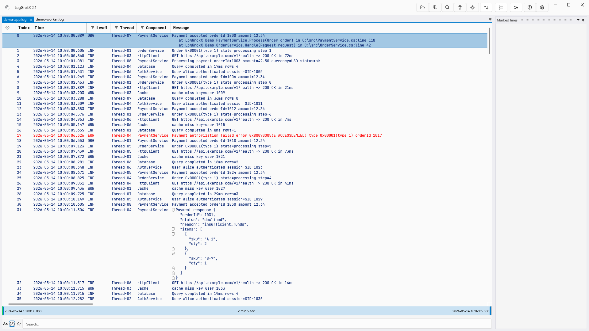

## Table of contents

- [⚡ Large file support](#-large-file-support)
- [🧩 Configurable log formats](#-configurable-log-formats)
- [📊 Column and field indexing](#-column-and-field-indexing)
- [🔍 Regex search](#-regex-search)
- [🧾 Filtering](#-filtering)
- [⏳ Time filter and timeline](#-time-filter-and-timeline)
- [📦 JSON/XML folding](#-jsonxml-folding)
- [🔣 HEX to text](#-hex-to-text)
- [🎨 Color rules](#-color-rules)
- [📌 Marked lines](#-marked-lines)
- [🔠 Text zoom](#-text-zoom)
- [🎯 Centered navigation](#-centered-navigation)
- [🧵 Thread grouping](#-thread-grouping)
- [🔁 Text transformations](#-text-transformations)
- [🔓 Base64 and PEM decoding](#-base64-and-pem-decoding)
- [🧷 Call stack symbols](#-call-stack-symbols)
- [🏷️ Value mappings](#️-value-mappings)
- [🔐 XOR-masked logs](#-xor-masked-logs)
- [🧱 Big lines](#-big-lines)
- [📑 Files and documents](#-files-and-documents)
- [🧭 Grid behaviour](#-grid-behaviour)
- [⚙️ Settings](#️-settings)
- [🌐 Interface languages](#-interface-languages)
- [🗂️ Configuration profiles](#️-configuration-profiles)
- [🌗 Light and dark themes](#-light-and-dark-themes)
- [🩺 Crash dumps](#-crash-dumps)
- [🛟 Support window](#-support-window)
- [🧬 Merged files view](#-merged-files-view)
- [🔄 Automatic updates](#-automatic-updates)

## ⚡ Large file support

**Business value.** Production logs routinely reach several gigabytes. LogGrokX
never loads a log into memory: it streams the file through a buffered,
line-aware reader and builds indexes in the background, while UI virtualization
keeps scrolling smooth. A file that would not open in a text editor becomes
interactive within seconds.

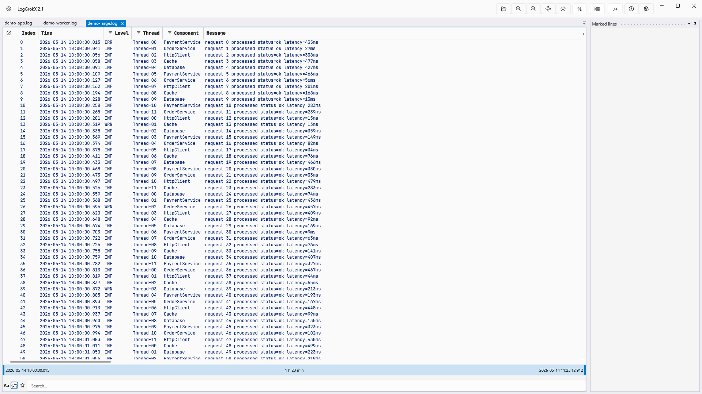

The timeline strip doubles as a density map of the **whole** file, so hotspots
(incident storms, restarts) are visible before any filtering:

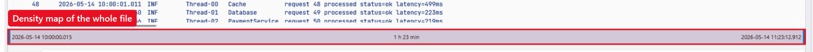

```csharp
using LogGrokX.Data;

var logFile = new LogFile(@"C:\logs\app.log", xorMask: 0);

using var loader = new Loader(logFile, lineProcessor, logger);
while (loader.IsLoading)
    await Task.Delay(100);

Console.WriteLine($"{logFile.FileSize} bytes indexed");
```

`LogFile` detects the encoding (including BOM-less UTF-16) and `Loader` drives
the background read. The `IItemProvider`/`VirtualList` abstraction in
`LogGrokX.Data.Virtualization` exposes only the visible window of lines to the
grid.

## 🧩 Configurable log formats

**Business value.** Every product logs differently. Instead of hard-coding a
parser, LogGrokX describes each format with a named-capture .NET regex in
`appsettings.yaml`. Several formats can coexist, so a single installation can
open logs from different components without changing code.

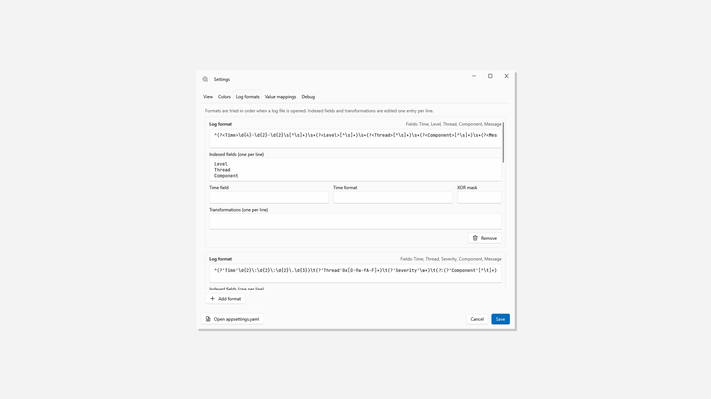

```yaml
LogFormats:
  - Regex: ^(?<Time>\d{4}-\d{2}-\d{2}\s[^\s]+)\s+(?<Level>[^\s]+)\s+(?<Thread>[^\s]+)\s+(?<Component>[^\s]+)\s+(?<Message>.*)
    IndexedFields:
      - Level
      - Thread
      - Component
```

```csharp
var format = new LogFormat
{
    Regex = @"^(?<Time>\d{4}-\d{2}-\d{2}\s[^\s]+)\s+(?<Level>[^\s]+)\s+(?<Thread>[^\s]+)\s+(?<Component>[^\s]+)\s+(?<Message>.*)",
    IndexedFields = new[] { "Level", "Thread", "Component" },
    TimeField = "Time",
    TimeFormat = "yyyy-MM-dd HH:mm:ss.fff"
};

if (!format.IsCorrect())
    throw new InvalidOperationException("The log format regex is invalid.");
```

Formats also support `Transformations` (ordered rewrites) and `XorMask`
(decoding encrypted files). See the
[Log format options](./README.md#log-format-options) table in the README.

## 📊 Column and field indexing

**Business value.** Once fields are declared under `IndexedFields`, they become
filterable columns and search facets. Instead of scrolling through millions of
lines, an operator can pivot on `Level`, `Thread` or `Component` and narrow the
view instantly.


Indexed fields are rendered as their own columns, next to the message:

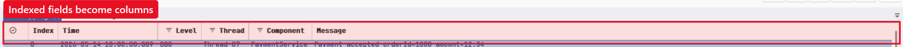

```csharp
var format = new LogFormat
{
    Regex = @"^(?<Time>\S+)\s+(?<Level>\w+)\s+(?<Thread>\S+)\s+(?<Message>.*)",
    IndexedFields = new[] { "Level", "Thread" }
};

var indexedFieldNumbers = format.IndexedFieldNumbers;
Console.WriteLine($"Indexing {indexedFieldNumbers.Length} fields");
```

The `Indexer`/`SubIndexer` in `LogGrokX.Data.Index` maps each distinct field
combination to a compact key and stores the line numbers per value, which is
what makes filtering and faceting fast.

## 🔍 Regex search

**Business value.** When a customer reports a failure, the fastest path to a
root cause is a precise search across a multi-gigabyte file. LogGrokX runs the
search asynchronously over the parsed buffer, reports live progress, and records
every hit so navigation and the timeline can jump to a result instantly.

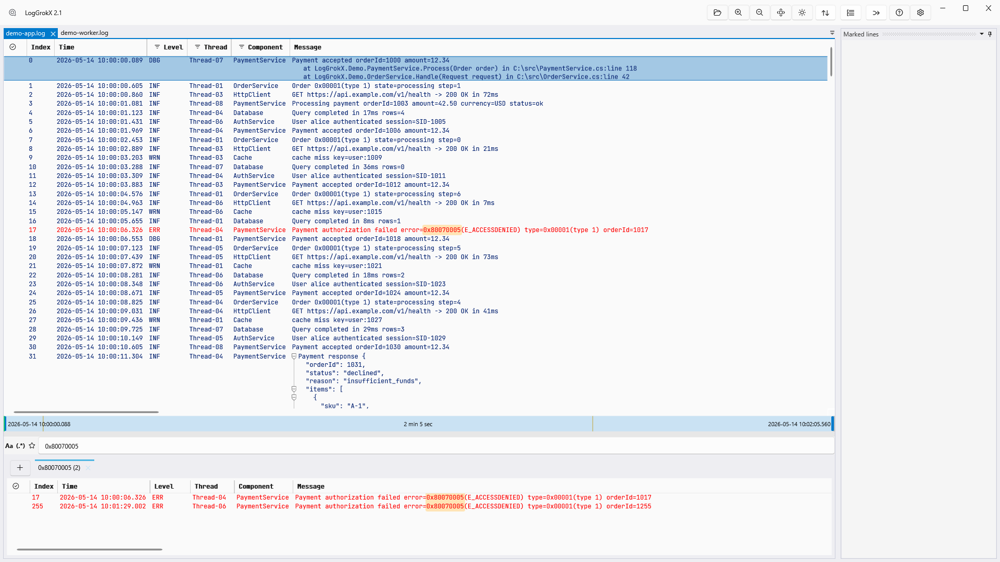

The search box supports **match case** and **regex** toggles, keeps an
**autocomplete** history, and lets frequently used patterns be **saved** and
reused:

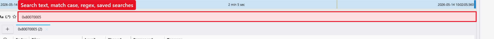

Every hit is listed with its parsed fields, ready to navigate:

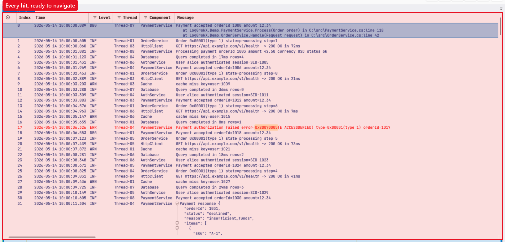

```csharp
using System.Text.RegularExpressions;
using LogGrokX.Data.Search;

var pattern = new Regex(@"Payment authorization failed", RegexOptions.IgnoreCase);

var (progress, searchIndexer, lineIndex) = Search.CreateSearchIndex(
    logModelFacade, pattern, cancellationToken);

await progress.Completion;

for (var hit = 0; hit < lineIndex.Count; hit++)
{
    var (sourceLine, offset, length) = lineIndex.GetLine(hit);
    Console.WriteLine($"Hit {hit} maps to source line {sourceLine}");
}
```

`Search.CreateSearchIndex` returns immediately; the pipeline fills
`searchIndexer` and `lineIndex` on a background task. Saved searches and the
autocomplete cache live in the search view model.

## 🧾 Filtering

**Business value.** Filtering removes noise without re-reading the file. Filter
by one or more indexed column values directly from the grid header; removable
chips show what is currently excluded, and the same index powers instant
recomputation of the visible set.

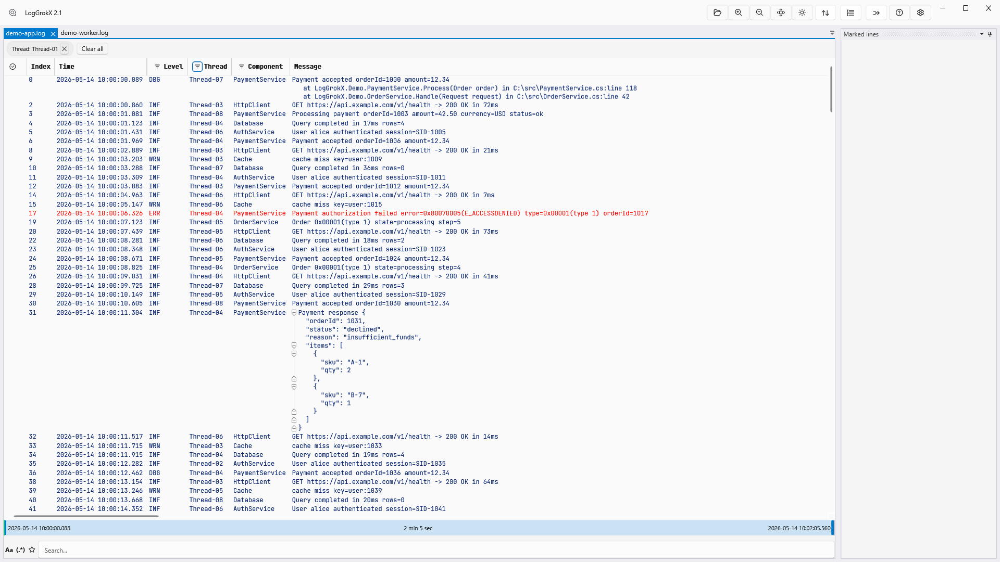

Active exclusions are shown as removable chips above the grid:

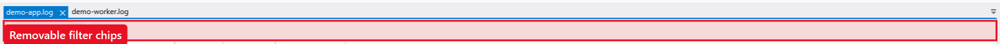

```csharp
IReadOnlyDictionary<int, IEnumerable<string>> excludedComponents =
    new Dictionary<int, IEnumerable<string>>
    {
        [2 /* Thread */] = new[] { "Thread-07", "Thread-08" }
    };

var isVisible = indexer.IsLineIncluded(lineNumber, excludedComponents);
```

`Indexer.IsLineIncluded` checks the precomputed key of a line against the
excluded values, so filtering a multi-gigabyte file stays interactive.

## ⏳ Time filter and timeline

**Business value.** Incidents have a "before" and "after". The timeline strip
(top or bottom) is a minimap of the whole file that lets you select a time range
with draggable handles — or line ranges when no timestamps are available — and
jump through marked lines. Narrowing to the interesting window turns a wall of
text into a readable sequence. Hovering the strip draws a vertical guide line
and the timestamp under the cursor (or `Line N` in line-number mode) directly in
the canvas, so the exact moment of a marker or match can be read without leaving
the strip.

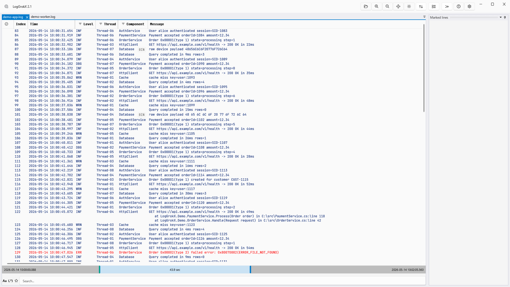

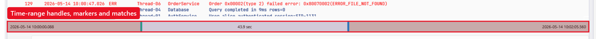

```csharp
var timeline = new TimeIndex();
foreach (var ticks in parsedTimestamps)
    timeline.Add(ticks);

if (timeline.FindLineRange(fromTicks, toTicks) is { } window)
{
    Console.WriteLine($"Visible source lines: {window.StartLine}..{window.EndLine}");
}
```

`TimeIndex` normalizes day-less timestamps (rolling them over midnight) and uses
binary search for `FindLineRange`; it is shared by the single-log and merged
timelines. The placement is persisted as `ViewSettings.TimelineAtTop`. The hover
readout is drawn in `Controls/LogMinimapControl.cs` (`DrawHoverTime` /
`GetHoverText`) using `TimeIndex.GetTicksAt` and `TimestampParser.Format`.

## 📦 JSON/XML folding

**Business value.** Many logs embed structured payloads as multi-line JSON, XML or
oversized strings that drown out the surrounding context. LogGrokX formats and
folds those blobs inline so the default view stays compact, while the folded
content can be expanded on demand. The folding state is shared across the log
grid, search results and the marked-lines view of the same document.

Collapsed, a whole JSON payload occupies a single line:

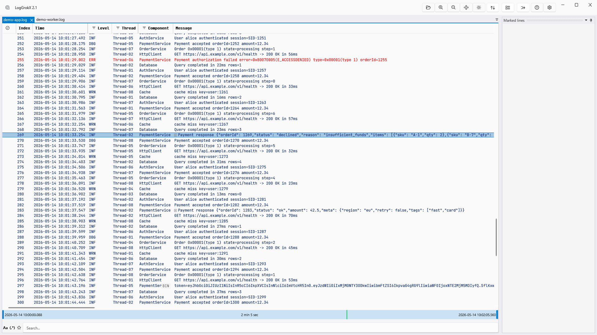

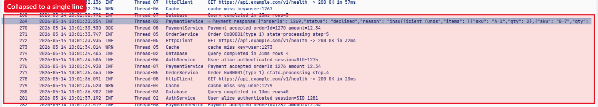

Expanding a region shows the formatted, indented JSON:

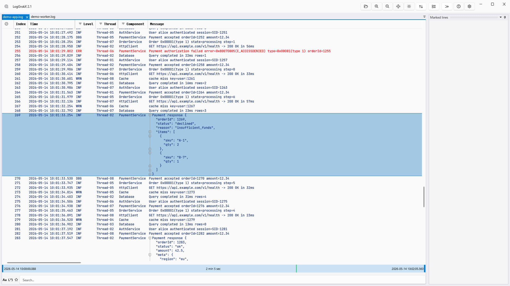

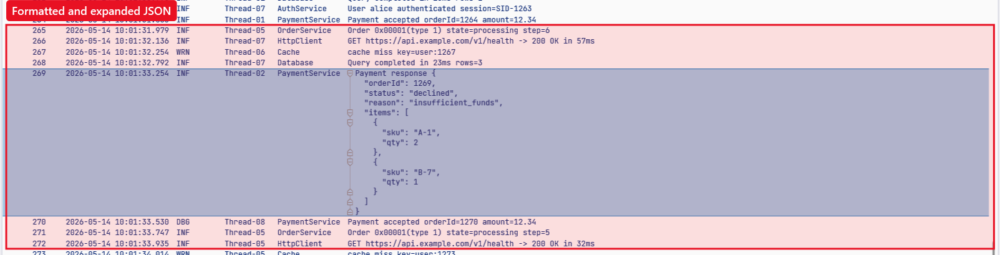

```csharp
using LogGrokX.Controls.TextRender;

// One folding state is registered per opened document and bound by the templates.
var foldingState = new TextViewSharedFoldingState();
```

XML fragments (optionally with an `<?xml ...?>` declaration) are recognized when
the root element has child elements; they are indented and every multi-line
element can be folded, just like JSON objects and arrays.

The implementation lives in `Controls/TextRender`
(`TextView`, `TextViewSharedFoldingState`, `CollapsibleRegionsMachine`,
`FoldingManager`). Templates bind it via `textRender:TextView.SharedFoldingState`
using the same `TextModel.UniqueId`, otherwise expansion falls out of sync.

## 🔣 HEX to text

**Business value.** Network, device and protocol logs often dump payloads as HEX
bytes. Reading `48656C6C6F20776F726C64` as `Hello world` by hand is slow and
error-prone. When a row contains HEX that decodes to readable text, the same
`BIN` toggle that decodes Base64/PEM (see [Base64 and PEM decoding](#-base64-and-pem-decoding))
appears; clicking it replaces the HEX fragments with the decoded string together
with any Base64/PEM in the row, clicking again restores the original value. Per
cell, HEX can be toggled separately with **Decode HEX** in the context menu.

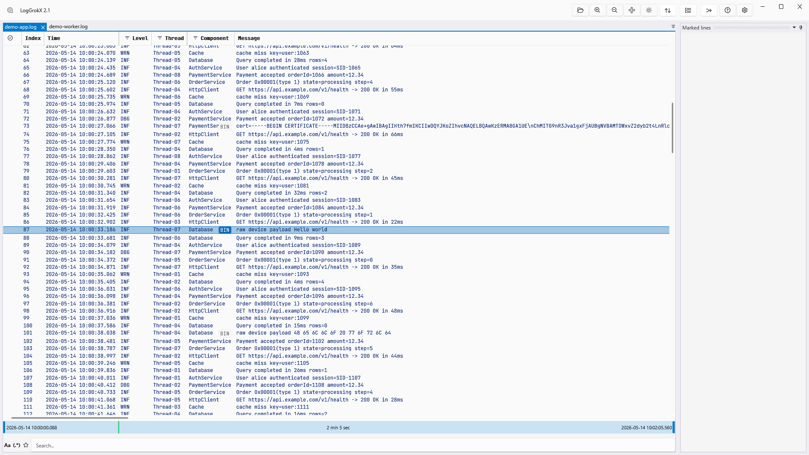

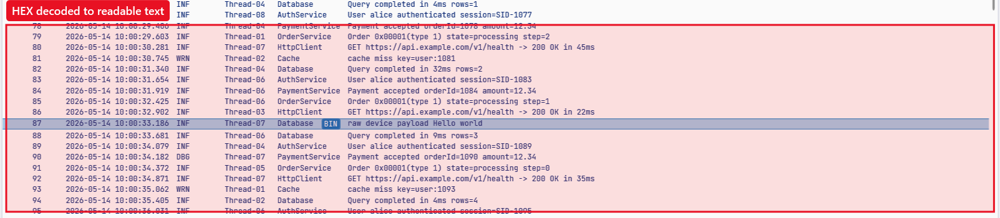

```csharp
using LogGrokX;

HexText.TryDecode("Received: 48 65 6C 6C 6F 20 77 6F 72 6C 64", out var text); // "Received: Hello world"
```

`HexText` finds runs longer than 64 bits, i.e. at least 9 bytes (contiguous, separated by space, `-`,
`:` or `,`, optionally `0x`-prefixed) and decodes them as UTF-8, then as
UTF-16LE. A run is converted only if the result is printable text with at least
one letter, so hashes, GUIDs and plain numbers are not treated as HEX. Anything up to 64 bits
(`0x80070005`, `0x4142434445464748`) is a number, and so is a contiguous token of
digits `0-9` only (`41424344454647484950`). HEX values
inside JSON strings and XML text/attributes are decoded too: the result is
escaped (`\"`, `\n`, `&lt;`, `&amp;`, ...), so the payload stays valid and keeps
its JSON/XML folding. HEX that decodes to JSON or XML is formatted as well.
Binary payloads are not decoded to text, but a HEX-encoded X.509 certificate,
SubjectPublicKeyInfo or CryptoAPI `PUBLICKEYBLOB` is recognized and shown as a
key description (like the Base64 path). "Copy" copies
the value as displayed; "Copy as native" keeps the original HEX.

## 🎨 Color rules

**Business value.** The eye finds errors faster than any search. Color rules
highlight matching lines and fragments, and because they are expressed as regex
rules in `appsettings.yaml`, severity conventions can be tuned per team without
a rebuild. Colors adapt to the active theme.

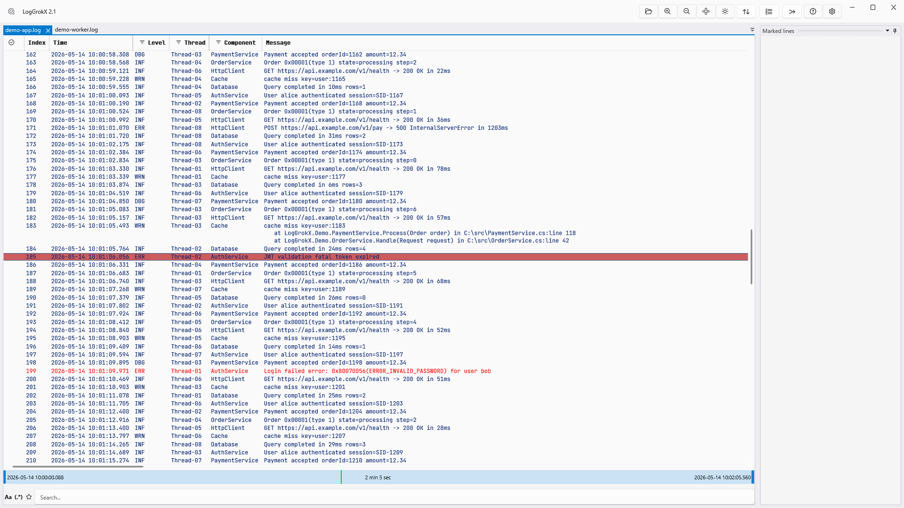

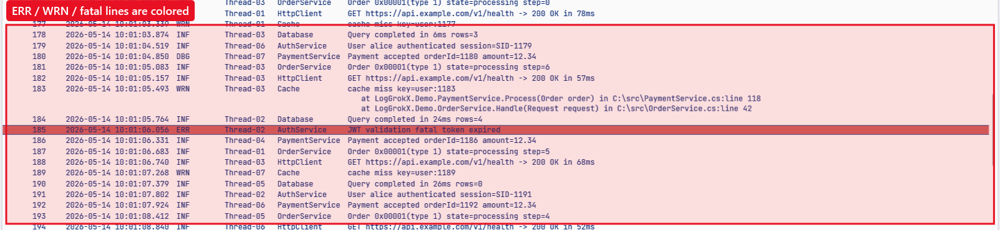

```yaml
ColorSettings:
  Rules:
    - RegexString: \tERR\t
      ForegroundColor: Red
    - RegexString: \tWRN\t
      ForegroundColor: Chocolate
    - RegexString: (?i)fatal
      BackgroundColor: "#FFCD5C5C"
```

Supported values are .NET `System.Drawing.Color` names or `#AARRGGBB`
notation; a rule without colors keeps the default foreground.

## 📌 Marked lines

**Business value.** During an investigation you often collect a handful of
needle lines across a huge haystack. Marking pins them into a dedicated view so
the evidence can be revisited, copied or compared without repeating the search.

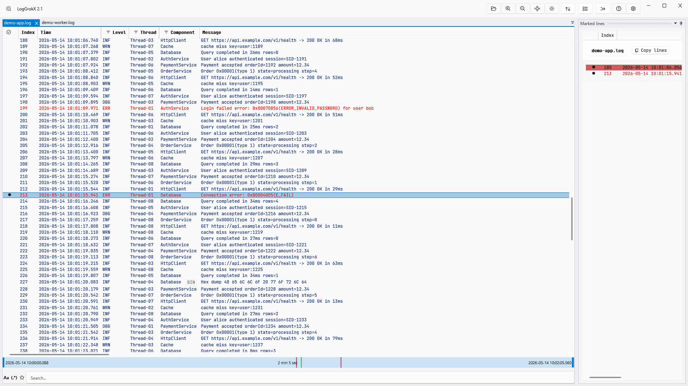

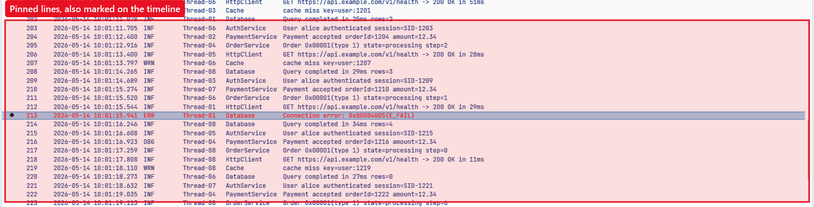

Marked lines are browsed from the dedicated "Marked lines" view; jumping to a
marked line centers the target row in the grid (see
[Centered navigation](#-centered-navigation)), and the marks also appear on the
timeline strip.

## 🔠 Text zoom

**Business value.** Operators work on different monitors and at different
distances. Log text can be scaled on the fly and the choice is remembered, so
readability preferences survive restarts.

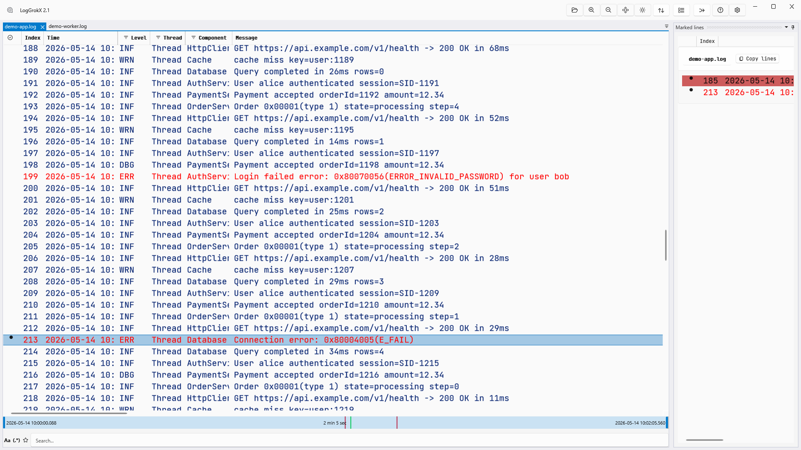

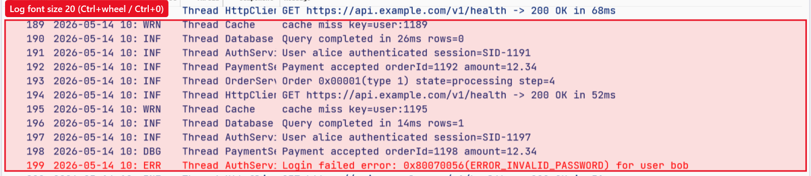

```csharp
var zoom = container.Resolve<TextZoomService>();

zoom.Increase();   // Ctrl + '+'
zoom.Decrease();   // Ctrl + '-'
zoom.Reset();      // Ctrl + '0'
zoom.SetFontSize(14);

Console.WriteLine($"Current log font size: {zoom.FontSize}");
```

`TextZoomService` clamps the size between its min/max, raises `Changed`, and
persists the value as `ViewSettings.LogFontSize`.

## 🎯 Centered navigation

**Business value.** Jumping to a search hit (including `F3`) or a marked line
centers the target row in the grid. That small detail keeps context visible on
both sides of the hit and makes result-by-result review much faster.

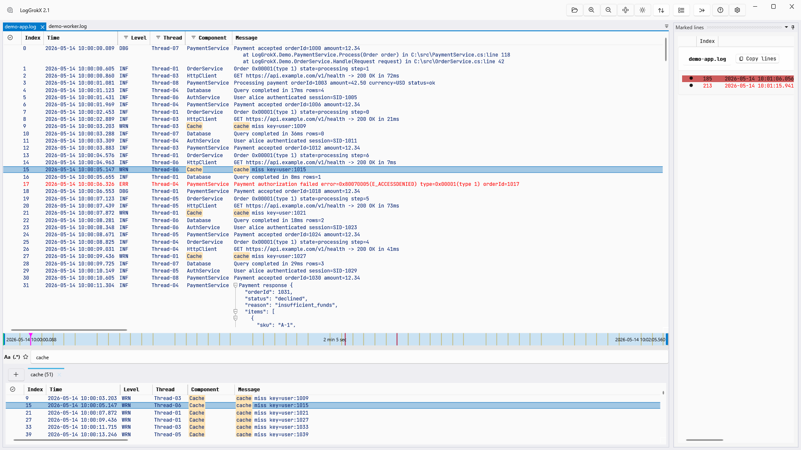

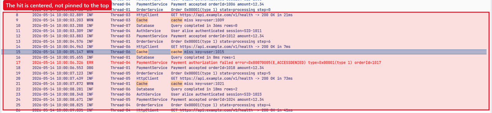

Navigation is driven by the document view model (`FindNext`/`FindPrevious`) and
`CurrentDocument`; the grid scrolls the target into the middle of the viewport
rather than to the top edge.

## 🧵 Thread grouping

**Business value.** Interleaved log lines from many worker threads are hard to
follow. Thread grouping collapses consecutive visible lines that share the same
`Thread` value, dims the repeated thread value on continuation rows, and adds
subtle dividers. Toggled from the title bar and persisted.

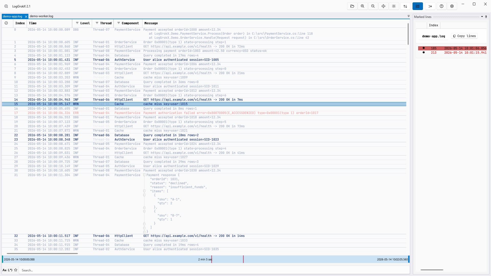

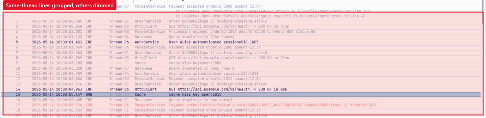

```csharp
var grouping = container.Resolve<ThreadGroupingService>();
grouping.SetEnabled(true);

if (grouping.IsEnabled)
    Console.WriteLine("Consecutive lines with the same Thread are grouped");
```

The boundaries are attached properties (`IsGroupFirst`, `IsGroupLast`,
`IsGroupContinuation`) on `BaseLogListViewItem`, computed by the custom
`VirtualizingStackPanel` and rendered by `Styles/ListViewItemStyle.xaml`. The
setting is `ViewSettings.GroupByThread`. The horizontal dividers between groups
are controlled separately by `ViewSettings.ShowThreadGroupSeparators` (default
`true`, toggled in **Settings -> View**); turning them off hides the top and
bottom group lines while keeping the dimmed thread value on continuation rows.

While grouping is on, the thread of the current line is in focus: rows of all
other threads are dimmed (`IsOtherThread`), and the search pane shows only the
matches of that thread. Moving to a line of another thread switches the focus
and re-filters the search results. In a single log the filter relies on the
indexed `Thread` field (`IndexedFields`); the merged view works per source file.

## 🔁 Text transformations

**Business value.** Logs frequently carry encoded payloads (Base64, compressed
or JSON-in-JSON). Transformations rewrite matched fragments before display, so
the readable value is shown inline without any external tooling.


```yaml
LogFormats:
  - Regex: ^(?<Time>\S+)\t(?<Thread>0x[0-9a-fA-F]+)\t(?<Severity>\w+)\t(?<Message>.*)
    Transformations:
      - lic\t\[.*ContentImp.*\].*"TicketBody"\s+:\s+\{[^}]+"Data"\s+:\s+(?<Base64Decode'"[^"]+")
```

Each entry under `Transformations` is itself a named-capture regex: the capture
name selects the decoder (for example `Base64Decode` or
`Base64DecodeFormatJson`) and the matched group is replaced with the decoded
text. Rules run in order.

## 🔓 Base64 and PEM decoding

**Business value.** Encoded payloads (request bodies, tokens, tickets) often
show up in logs without a configured transformation. LogGrokX recognizes them
on the fly, so a single click reveals the readable value without copying it
into an external decoder.

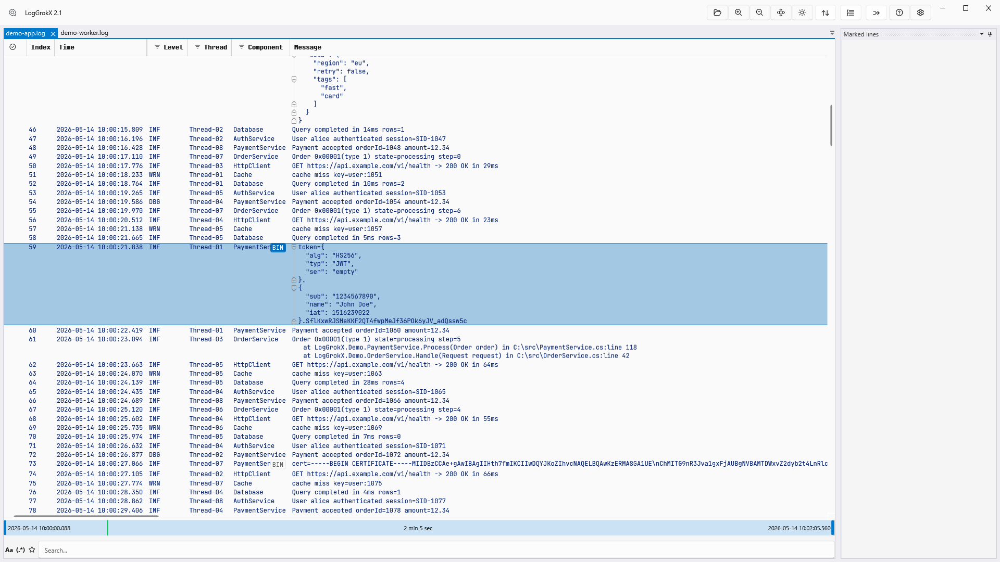

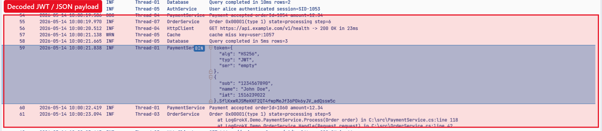

Multi-line **PEM** blocks are decoded the same way, the markers are kept and the
body becomes a readable certificate summary (or text / hex dump):

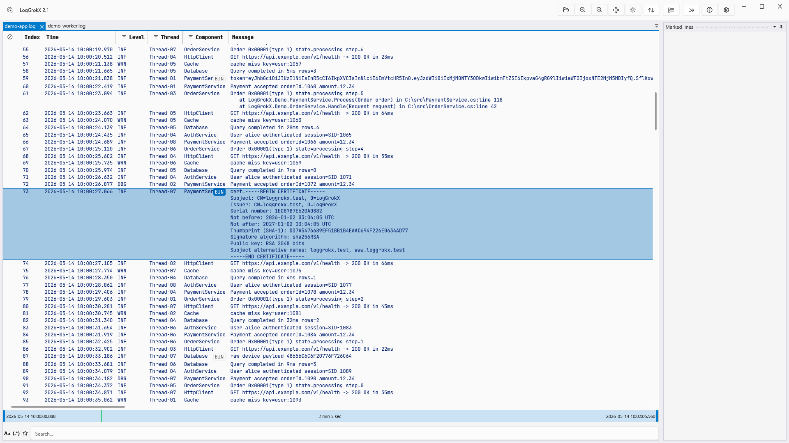

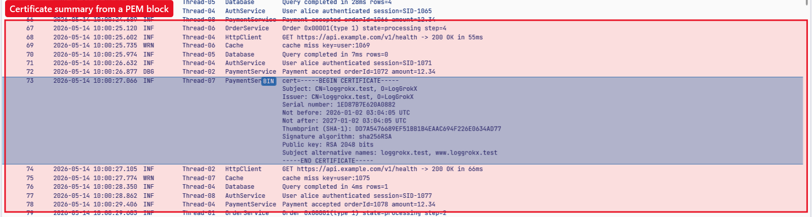

When a cell value is Base64 — either the whole value (optionally quoted) or a
fragment of at least 16 characters inside it, such as `payload=eyJ...` or the
segments of a JWT, also when glued to surrounding text such as
`https://host/api/eyJ...` or `X-Token-eyJ...` — a small `BIN` toggle appears
at the right edge of the `Component` column, so the log text does not shift and
the row does not grow. If the log format has no `Component` field (and in the
marked lines view) the toggle is shown under the mark pin instead. It switches
the whole row between the original and the decoded view and decodes everything
found in all fields at once: Base64 and PEM (see below). Per cell, the two kinds
can be toggled separately with **Decode Base64** and **Decode PEM** in the cell
context menu. Decoded JSON is
formatted and can be folded like any other JSON block, and **Copy** copies the
decoded text while it is shown.

Multi-line **PEM** blocks (`-----BEGIN <LABEL>-----` … `-----END <LABEL>-----`)
are recognized as a whole: line breaks inside the body may be real (`LF`/`CRLF`)
or escaped (`\n`, `\r\n` inside a JSON string). Such a cell is decoded by
the same `BIN` toggle, and per cell by the **Decode PEM** context menu item,
independently of **Decode Base64**. Lines of a PEM body are never treated as
Base64 fragments. The
markers are kept and the body is replaced with readable content:

- a certificate (`CERTIFICATE`, `TRUSTED CERTIFICATE`, `X509 CERTIFICATE`) is
  shown as a summary — subject, issuer, serial number, validity (UTC),
  SHA-1 thumbprint, signature algorithm, public key and subject alternative
  names;
- a text payload is shown as text;
- any other binary payload (keys, CSRs, …) is shown as a hex dump (the first
  4 KB).

```text
-----BEGIN CERTIFICATE-----
Subject: CN=loggrokx.test, O=LogGrokX
Issuer: CN=loggrokx.test, O=LogGrokX
Serial number: 5A1C…
Not before: 2026-01-02 03:04:05 UTC
Not after: 2027-01-02 03:04:05 UTC
Thumbprint (SHA-1): 8F3B…
Signature algorithm: sha256RSA
Public key: RSA 2048 bits
Subject alternative names: loggrokx.test, www.loggrokx.test
-----END CERTIFICATE-----
```

Binary keys that are logged as plain Base64 without PEM markers are treated
like PEM too (`BIN` toggle, **Decode PEM** menu item): a DER **X.509 certificate**
(`MII...`, shown with the same summary prefixed by `X.509 certificate`), a DER
**SubjectPublicKeyInfo** public key, and a Windows **CryptoAPI
PUBLICKEYBLOB** RSA key (`BgIAAACkAABSU0Ex...`: algorithm, key size, public
exponent and modulus). Other binary Base64 is not decoded.

Base64 and PEM are also recognized **inside JSON and XML** (the same blocks that
are formatted and folded). Values are unescaped first — JSON escapes such as
`\u002B`, `\/`, `\n` and XML entities such as `&#xA;` or `&amp;` — and the
decoded value is written back so the document stays valid and keeps folding:

- JSON: a value that decodes to JSON becomes a nested object/array, a
  multi-line result (e.g. a PEM certificate summary) becomes an array of lines,
  anything else stays an escaped string; keys are never decoded;
- XML: element text, attribute values and CDATA are decoded and re-escaped
  (`&lt;`, `&amp;`, `&quot;` …).

```text
{"token":"eyJhbGciOiJIUzI1NiIsInR5cCI6IkpXVCIsInNlciI6ImVtcHR5In0","n":1}
→ {"token":{"alg":"HS256","typ":"JWT","ser":"empty"},"n":1}
```

Both the standard (`+/`) and URL-safe (`-_`) alphabets are accepted, with or
without padding. A fragment is decoded only if the result is valid UTF-8
without control characters, so identifiers, GUIDs, hex strings and binary data
are left untouched.

```csharp
using LogGrokX.Data;

if (Base64Detector.TryDecode("payload=eyJpZCI6NDIsIm9rIjp0cnVlfQ== accepted", out var decoded))
    Console.WriteLine(decoded); // payload={"id":42,"ok":true} accepted
```

### Turning binary detection off

Binary data detection is on by default. In **Settings → View → Binary data
detection** it can be switched off completely (**Detect binary data (BIN)**) or
per kind: **PEM blocks, certificates and keys** (PEM blocks plus Base64 DER
certificates, public keys and CryptoAPI key blobs), **Base64 text** and **HEX**.
A disabled kind is not detected, so it does not show the `BIN` toggle or its
**Decode …** context menu item. The choice is applied to lines shown after
saving; reopen the log to apply it to every line.

```yaml
  ViewSettings:
    DetectBinary: true   # false turns off all kinds below
    DetectPem: true
    DetectBase64: true
    DetectHex: true
```

## 🧷 Call stack symbols

Messages that contain call stack frames are resolved to function names and
source lines through a symbol server, like in WinDbg. Supported frame formats:

```text
Call stack:
 0# test_.dll!38B3DC8D-3D1D-FADD-E67B-593D48ABEC14,1!86da0   module!PDB GUID,age!RVA
 1# kernel32.dll!14ad                                        module!RVA
 2# ntdll.dll+0x5aa58                                        module+0xRVA
```

- Such a cell gets a `SYM` toggle under `BIN` and a **Resolve call stack**
  context menu item: the frames are replaced in place with
  `module!Function+0x1a [file @ line]` (the state survives scrolling, like `BIN`).
  Nothing is downloaded until the toggle is pressed: symbols are loaded in the
  background only for that cell, until then a frame shows "resolving symbols…".
- **Show call stack** in the context menu opens a window with the frames
  (module, function, source location) and a source viewer: clicking a source
  location (or selecting a frame) loads and shows the file with the frame line
  highlighted; **Open in editor**
  opens it with the associated application. The PDB search attempts are shown
  in the function tooltip when symbols are not found.
- The PDB is looked up by its GUID and age (frames with the
  `module!GUID,age!RVA` form) in symbol stores, symbol servers (HTTP and file
  shares, including `file.ptr`) and plain folders. Without a GUID, a PDB with the
  module name from a plain folder is used.
- Sources are looked up in the local source folders (by the longest matching
  path suffix) and, with `srv*`, through the source server data (`srcsrv`
  stream) of the PDB: HTTP sources are downloaded to the cache; command-based
  sources (TFS `tf.exe`, git, …) are extracted only if **Allow source server
  commands** is enabled.

Settings → **Symbols** (or `appsettings.yaml`, applied without restart):

```yaml
  SymbolSettings:
    Enabled: true
    # WinDbg syntax; empty uses _NT_SYMBOL_PATH
    SymbolPath: 'srv*C:\Symbols*https://msdl.microsoft.com/download/symbols;\\build\symbols'
    SourcePath: 'srv*;C:\Sources'
    # Empty uses %LOCALAPPDATA%\LogGrokX\Symbols
    CachePath: ''
    AllowSourceServerCommands: false
```

Symbols are read with `dbghelp.dll` from Windows; **Reload symbols** in the call
stack window forgets the cached results and searches the symbol path again.

## 🏷️ Value mappings

**Business value.** Logs are full of numeric codes, enum values and
identifiers (`0x00001`, `0x80070005`, `3`) whose meaning lives in a header file
or a wiki page. Value mappings show that meaning right next to the value, so
the log can be read without looking codes up.

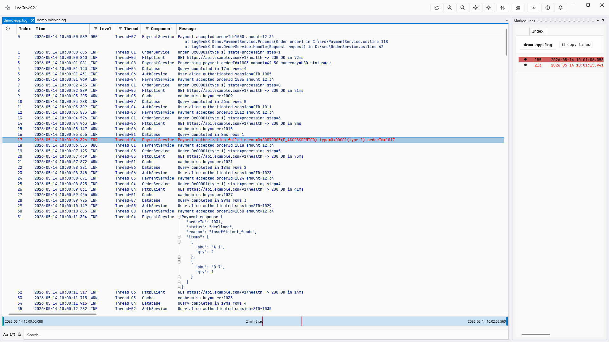

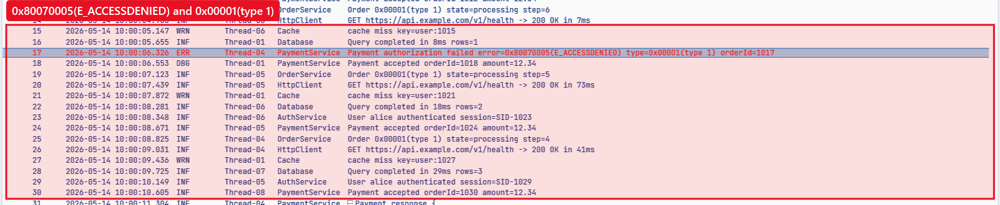

A value found in a mapping list is displayed as `value(mapping)`:

```text
request type 0x00001 failed: 0x80070005
→ request type 0x00001(type 1) failed: 0x80070005(E_ACCESSDENIED)
```

Mappings are edited in **Settings → Value mappings**. Each list has a name, an
**Enabled** switch, **Ignore case** and **Fields**: a comma-separated list of
fields (columns) the list applies to; empty means every field. The marked-lines
view and the whole-line text of the merged view use only lists without fields.

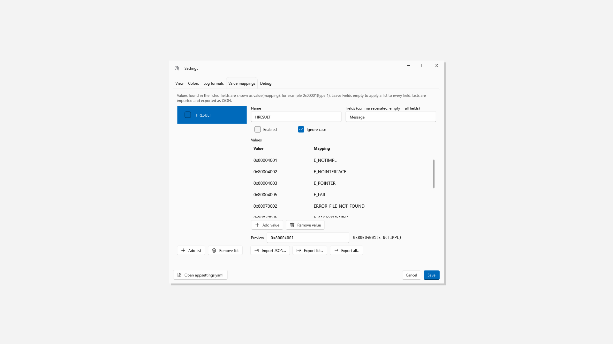

A value matches only as a whole token (`0x00001` is not mapped inside
`0x000010`); the longest value wins and the first list wins for the same value.
The **Preview** box shows how a sample text is displayed.

Inside JSON string values are mapped inside their quotes and numbers are mapped
as a trailing `5 /*mapping*/` comment (so the number stays a number; property
names are not mapped), inside XML element text, attribute values and CDATA; the
mapping is escaped, and if the fragment would no longer be the same JSON/XML it
is left unchanged, so folding keeps working. JSON comments written by mappings
are tolerated from `JsonCommentHandling.Skip` and preserved when the fragment is
formatted and folded. Mappings change only what is displayed (and copied):
search, filters, color rules and indexes work on the original values. Changes
apply to lines shown after saving; reopen the log to apply them to every line.

```yaml
  ValueMappings:
    - Name: Types
      Enabled: true
      IgnoreCase: true
      Fields:
        - Message
      Items:
        - Value: 0x00001
          Mapping: type 1
```

**Import / export.** **Import JSON...** adds lists from one or more files (a
list with the same name is replaced), **Export list...** writes the selected
list and **Export all...** writes every list. Changes are applied after
**Save**. Import accepts a list object, an array of lists or a plain
`{"value": "mapping"}` object (the file name becomes the list name):

```json
[
  {
    "Name": "Types",
    "Enabled": true,
    "IgnoreCase": true,
    "Fields": [ "Message" ],
    "Items": [
      { "Value": "0x00001", "Mapping": "type 1" },
      { "Value": "0x00002", "Mapping": "type 2" }
    ]
  }
]
```

```csharp
using LogGrokX.Data;

var mapper = new ValueMapper(ValueMappingJson.Deserialize("{ \"0x00001\": \"type 1\" }"));
Console.WriteLine(mapper.ForField("Message").Map("got 0x00001")); // got 0x00001(type 1)
```

## 🔐 XOR-masked logs

**Business value.** Some vendors obfuscate logs with a single-byte XOR key.
LogGrokX transparently de-obfuscates such files while streaming, so they can be
opened and searched like any other log — no manual decode step.

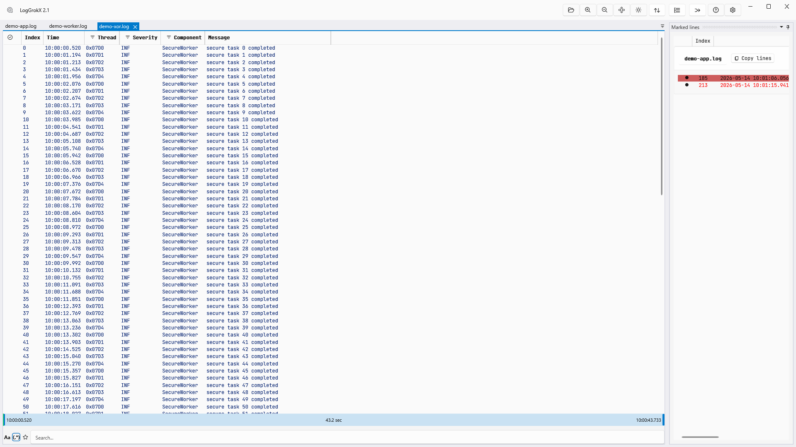

```csharp
var masked = new LogFile(@"C:\logs\encrypted.log", xorMask: 0xEF);

using var loader = new Loader(masked, lineProcessor, logger);
```

`LogFile` wraps the file stream in `MaskedStream(fileStream, xorMask)`, and the
same key can be declared per format as `XorMask` in `appsettings.yaml`.

## 🧱 Big lines

**Business value.** A single malformed record — an embedded blob, a minified
JSON document, a binary dump — can be hundreds of kilobytes long. Letting it
through verbatim stalls layout and buries everything around it. LogGrokX caps
oversized lines so the grid stays responsive and readable.


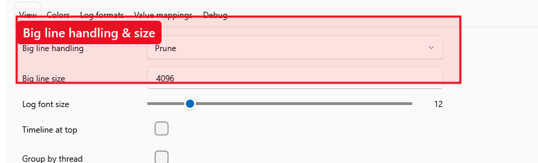

Two modes are configured in **Settings → View** (`ViewSettings.BigLine`):

- **prune** — a line longer than `BigLineSize` characters is truncated and an
  ellipsis is appended, keeping one row per record;
- **break** — such a line is wrapped into chunks of `BigLineSize` characters,
  so nothing is lost from the view.

```yaml
  ViewSettings:
    BigLine: prune       # prune | break
    BigLineSize: 4096    # characters per chunk
```

The original, untruncated text is still kept for **Copy**.

## 📑 Files and documents

**Business value.** Real investigations compare several logs at once. LogGrokX
hosts dockable tabs powered by AvalonDock, so documents can be opened, closed,
rearranged and auto-hidden without losing their state. Command-line paths are
opened as documents on startup.

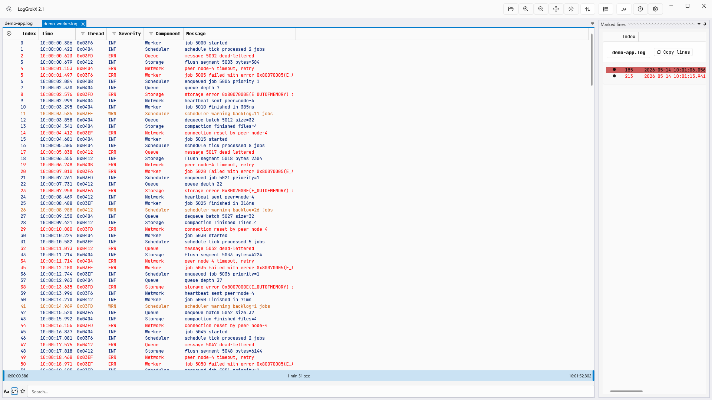

```powershell
LogGrokX.exe C:\logs\app.log C:\logs\worker.log
```

```csharp
// The application forwards command-line paths to the main view model.
foreach (var path in commandLine)
    mainViewModel.AddDocument(path);
```

Additional ways to open files:

- **Drag & drop** one or more files anywhere onto the window.
- **Document tab context menu** on a tab header:
  **Copy path**, **Copy file name** and **Open containing folder**, so a path
  can be shared or the log located on disk without leaving the app.

## 🧭 Grid behaviour

**Business value.** Reading wide, structured logs means going back and forth
between distant columns and long messages. A few grid conveniences keep that
navigation comfortable:

- **Horizontal scrolling** — the grid scrolls horizontally when the parsed
  columns are wider than the viewport, so no field is unreachable.
- **Auto-width columns** — double-clicking a column header separator sizes the
  column to its content; the `Message` column can be widened once and stays.
- **Copy** — `Ctrl+C` copies the selected lines as displayed (after any textual
  transformation, Base64/HEX decoding or value mapping); the per-cell context
  menu offers **Copy** and **Copy as native** (the original, undecoded value).
- **Centered, keyboard-driven navigation** — arrow keys move the current line,
  `F3`/`Shift+F3` step through search hits, all centering the target row (see
  [Centered navigation](#-centered-navigation)).

## ⚙️ Settings

**Business value.** Everything tunable lives in one place. Most changes apply
without restarting the app; changing the interface language requires a restart.
The same values can be edited by hand in `appsettings.yaml`,
which is watched and hot-reloaded.

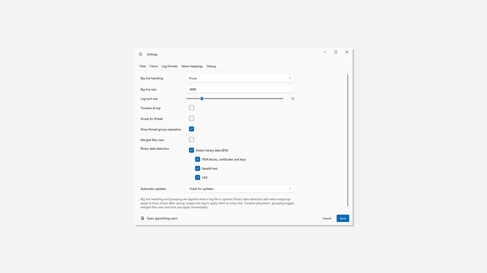

The Settings window is organised into tabs:

| Tab | Contents |
| --- | --- |
| **View** | Interface language, text size, thread grouping and separators, timeline placement and visibility, merged view, binary detection, big lines, update mode. |
| **Profiles → Colors** | Named profiles and their foreground/background color rules. |
| **Profiles → Log formats** | Each profile's regular expressions, indexed fields, transformations, time parsing and XOR mask. |
| **Value mappings** | The mapping lists and their JSON import/export. |
| **Debug** | Crash dumps and diagnostics. |

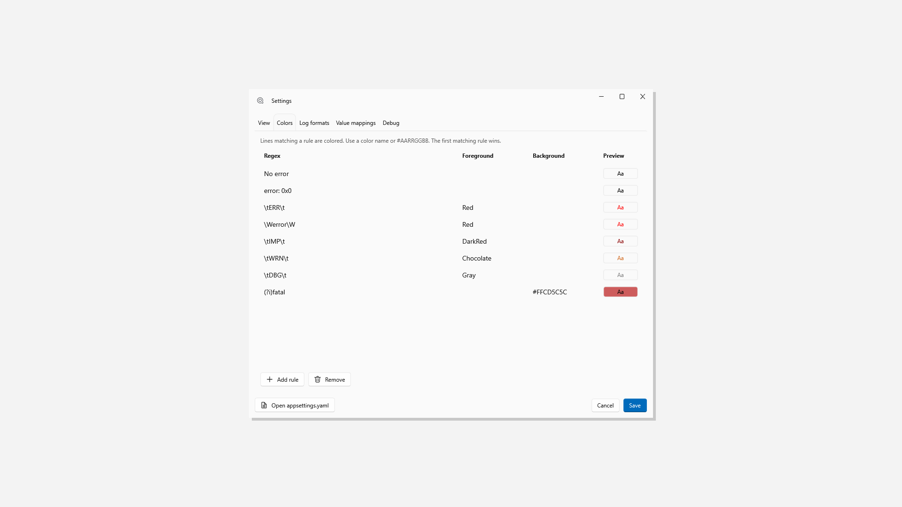

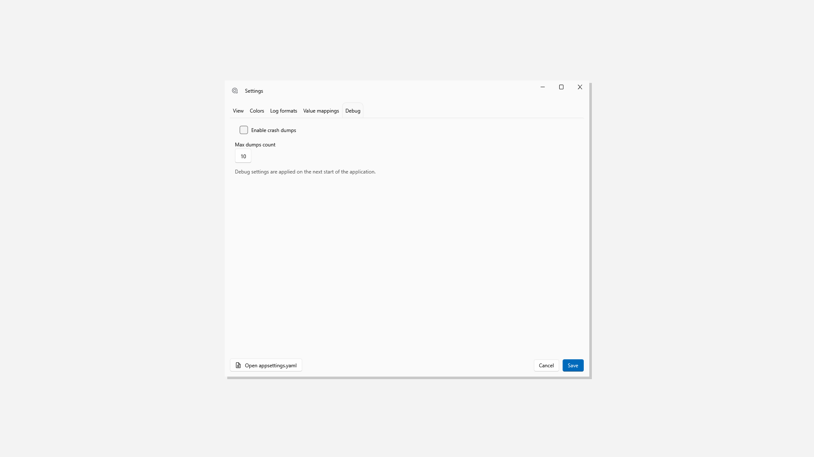

Open it from the **settings** button in the title bar; changes take effect after
**Save** (a few options only apply to logs opened afterwards).

The title bar groups file opening, text zoom, timeline placement, thread
grouping, merged view, theme, support and settings tools beside the profile
selector. Hover an icon for its tooltip. The timeline button cycles through
top, bottom and hidden; search remains available with `Ctrl+F`, `F3` and
`Shift+F3`.

## 🌐 Interface languages

**Business value.** Teams can use the same viewer in their preferred language
while sharing log files and configuration without translating their contents.
The interface, settings and installer support **English, Russian, German,
French, Spanish, Japanese, Polish and Brazilian Portuguese**.


1. Open **Settings → View → Language**.
2. Select a language, or **System language** to follow Windows.
3. Click **Save**, then restart LogGrokX.


A fresh installation starts in the language selected in Setup. Portable builds
follow the system language by default, falling back to English for an unsupported
language. The saved choice survives upgrades. Log text, field names and column
headers, profile names and YAML keys keep their original text.

```yaml
Settings:
  ViewSettings:
    Language: system  # system | en | ru | de | fr | es | ja | pl | pt-BR
```

## 🗂️ Configuration profiles

**Business value.** Switch between products or log families without replacing
the whole configuration. Each named profile holds its own **log formats** and
**color rules**. View options, language, binary detection, value mappings,
updates and diagnostics are shared across profiles.


1. Open **Settings → Profiles** and select a profile.
2. Use **New** for an empty profile or **Copy** to duplicate the selected one;
   enter a unique, non-empty name. **Remove** deletes a profile, but at least
   one must remain.
3. Edit its **Colors** and **Log formats** tabs, then click **Save**. The profile
   selected in Settings becomes active when saved.

For everyday switching, use the **profile selector in the main title bar**.
The selection takes effect immediately, is saved, and applies to **all open
documents** and subsequently opened files. Changing formats or colors rereads
the open logs and preserves marked lines; renaming a profile with unchanged
configuration does not trigger a reparse. If a profile cannot be applied, the
last successfully applied configuration stays in use.

Fresh configurations include **Classic** (the original formats and colors),
**Venn** (its own structured format and colors) and **Plain text** (whole-line
text without color rules). Upgrades preserve the existing configuration, so
these bundled profiles are not automatically added to an older installation.

```yaml
Settings:
  SelectedProfile: Application
  Profiles:
    - Name: Application
      InheritLegacySettings: false
      ColorSettings:
        Rules:
          - RegexString: '\bERROR\b'
            ForegroundColor: Red
      LogFormats:
        - Regex: '^(?<Time>\d{4}-\d{2}-\d{2}\s[^\s]+)\s+(?<Level>[^\s]+)\s+(?<Thread>[^\s]+)\s+(?<Component>[^\s]+)\s+(?<Message>.*)'
          IndexedFields: [Level, Thread, Component]
    - Name: Plain text
      InheritLegacySettings: false
      ColorSettings:
        Rules: []
      LogFormats: []
```

Older configurations with only `Settings.ColorSettings` and `Settings.LogFormats`
appear as **Default**. For hand-written profiles, missing sections inherit these
legacy settings unless `InheritLegacySettings: false` is set; explicit empty
lists stay empty. Profiles saved through Settings are self-contained.

## 🌗 Light and dark themes

**Business value.** Log review happens in bright offices and dark NOCs alike.
The theme is applied to the whole application — chrome, log colors and search
highlighting. The window deliberately uses solid theme colors instead of the
Windows 11 Mica material, which is incompatible with AvalonDock's auto-hide
flyout.

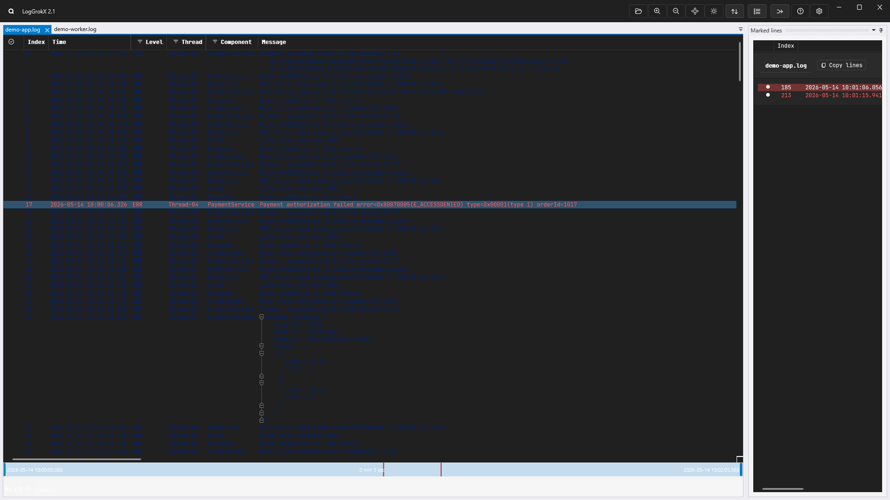

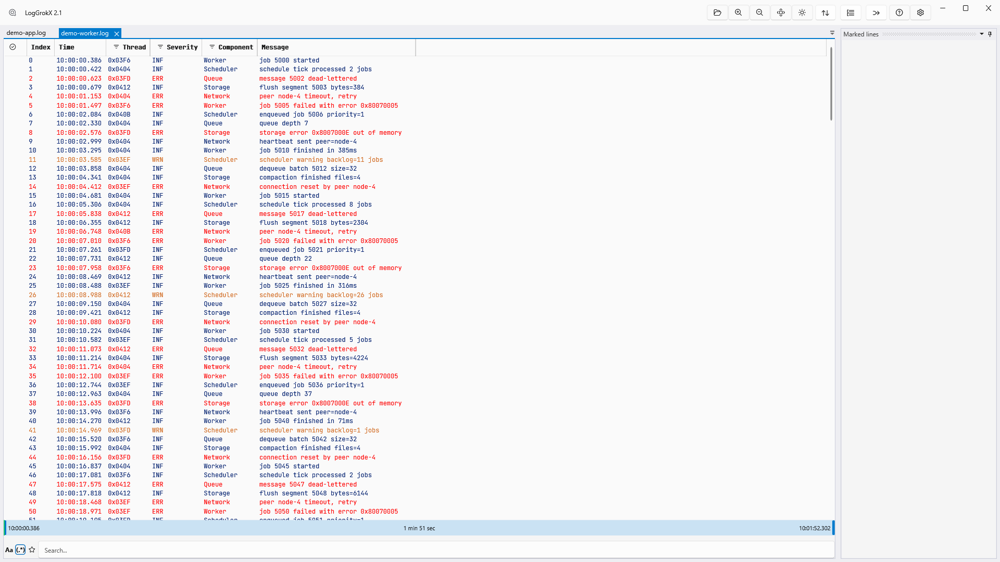

```csharp
var themeService = container.Resolve<UiThemeService>();
themeService.Apply(UiThemeService.DarkTheme);

if (themeService.IsDark)
    Console.WriteLine($"Active theme: {themeService.CurrentTheme}");
```

The selected theme is stored in `%LOCALAPPDATA%\LogGrokX\Data\Theme.json` and
re-applied on startup by `UiThemeService.ApplySavedTheme`. Reference
`DynamicResource` brushes in custom styles so both themes keep working.

## 🩺 Crash dumps

**Business value.** A crash in a log viewer is worst exactly when it happens on
a critical incident. Optional Windows Error Reporting local dumps capture the
state for diagnosis, and the feature can be toggled without reinstalling.


```yaml
DebugSettings:
  # Restart required after changing debug settings
  EnableCrashDumps: true
  MaxDumpsCount: 10
```

Dumps are written under `%LOCALAPPDATA%\LogGrokX\Dumps`. `EntryPoint` configures
the WER `LocalDumps` registry key on startup and cleans it up when disabled.

## 🛟 Support window

**Business value.** When users report a problem, diagnostics are the slow part.
The Support window collects version, git commit and branch, .NET runtime, OS and
CPU architecture, lets you check for updates manually, and offers one-click links to the latest release, the issue
tracker and the source, plus "copy diagnostics" and "open logs folder".

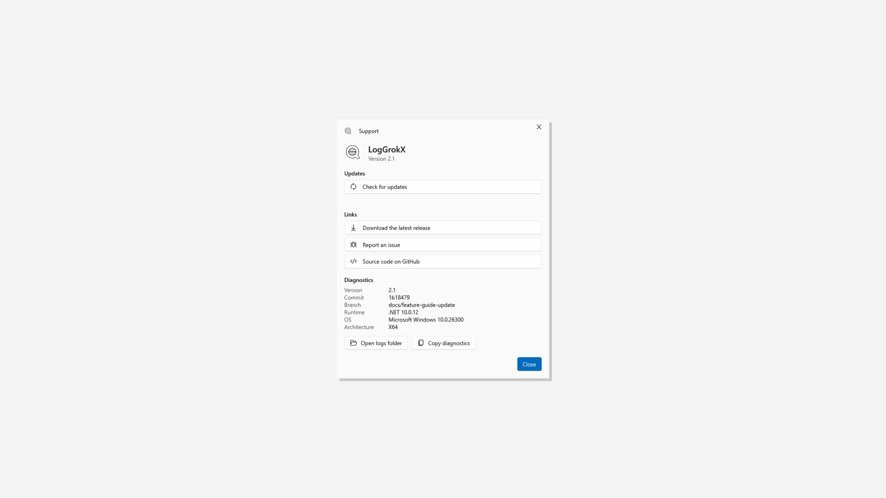

Open it with the `?` button in the title bar (`OpenSupportCommand`). Diagnostic
logs live in `%LOCALAPPDATA%\LogGrokX\`; the UI is `SupportWindow.xaml` /
`SupportViewModel`.

## 🧬 Merged files view

**Business value.** A single request usually spans several logs written in
different formats by different components. The merged files view combines any
number of opened documents into one **time-ordered** grid: rows are interleaved
by timestamp, columns are aligned case-insensitively across formats, plain-text
lines fall back into `Message`, and `Level`/`Severity` are unified into a single
`Severity` column. Rows are tinted per source, and search, time filtering,
thread grouping, JSON folding and marking all keep working.

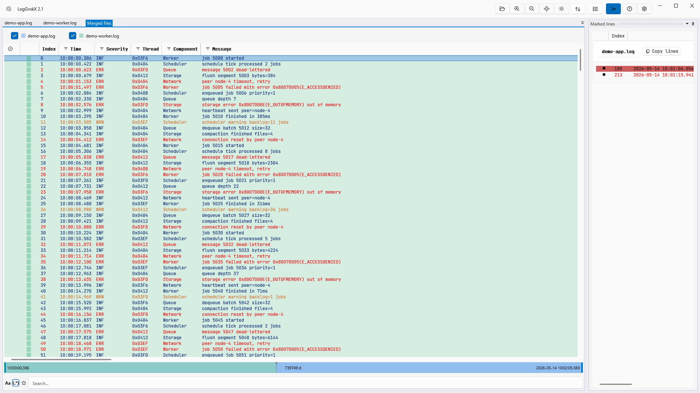

```csharp
using LogGrokX.Data;

var firstTimes = new TimeIndex();
foreach (var ticks in firstLogTimestamps)
    firstTimes.Add(ticks);

var sources = new List<MergeSource>
{
    new MergeSource(firstLogLineCount, firstTimes),
    new MergeSource(secondLogLineCount, secondTimes)
};

var merged = MergedLineOrder.Build(sources);
var timeline = MergedLineOrder.BuildTimeIndex(merged);

if (timeline.FindLineRange(fromTicks, toTicks) is { } window)
{
    for (var i = window.StartLine; i < window.EndLine; i++)
    {
        var line = merged[i];
        Console.WriteLine($"source={line.SourceIndex} line={line.LineNumber}");
    }
}
```

`MergedLineOrder.Build` performs a k-way merge with a priority queue, so the cost
is proportional to the number of lines rather than the number of sources. The
view is toggled by `MergedFilesViewService` and persisted as
`ViewSettings.MergedFilesView`.

## 🔄 Automatic updates

**Business value.** Users stay on the latest fixes without visiting GitHub. LogGrokX
checks for a newer release at most once a day and, with one click, installs it
silently when the application is closed.

- On startup (and hourly while running) the app asks the GitHub
  `releases/latest` API for the newest version, but no more than once every
  24 hours.
- If a newer version exists, the **Update available** dialog shows the release
  notes with **Update**, **Later** and **Skip this version**.
- **Update** downloads the installer for the current architecture, verifies it
  against `SHA256SUMS.txt`, and runs it in silent mode after LogGrokX exits.
  Program Files installs ask for UAC elevation.
- Portable builds cannot self-update: the button opens the release page instead.
- **Check for updates** in the Support window runs a check right away, ignoring
  the daily limit and skipped versions.
- Choose the mode in **Settings → View → Automatic updates**:
  - **Do not check for updates** — no automatic checks (manual check still works);
  - **Check for updates** — show the dialog when a new version is found;
  - **Install updates automatically** — download the new version in the
    background without a dialog and install it silently on exit.
- After the update is applied, the next launch shows a **What's new** window with
  the release notes of the installed version and a link to the release page. The
  notes are captured when the installer is downloaded, stored in
  `%LOCALAPPDATA%\LogGrokX\Data\pending-update.json`, shown once the running
  version matches the release, and then removed.
- The installer has one option, **Install updates automatically**: checked sets
  `install`, unchecked sets `check`. Silent auto-update runs keep the user's choice.

```yaml
  ViewSettings:
    UpdateMode: check   # disabled | check | install
```

> This dialog only appears when a newer release exists, so it is not shown in
> the screenshots above; the mode is configured on the **View** settings tab.

## Missing a feature?

If a capability you rely on is not covered here, or you would like to see a
feature demonstrated, please
[open an issue](https://github.com/zhenyatnk/LogGrokX/issues) describing your
use case. Bug reports, format requests and documentation improvements are all
welcome.
